<!-- Generated by scripts/build.mjs from profile.config.json. Edit those, not this file. -->

<picture>
  <source media="(prefers-color-scheme: dark)" srcset="cards/coding-dark.svg">
  
</picture>

<a href="https://inworks.ahmedatif.in">inworks.ahmedatif.in</a> &nbsp;/&nbsp; <a href="https://ruyah.ahmedatif.in">ruyah</a> &nbsp;/&nbsp; <a href="https://quexchange.vercel.app">quexchange</a> &nbsp;/&nbsp; <a href="https://github.com/SigniorAtif/Rury-dot-files">dotfiles</a>

